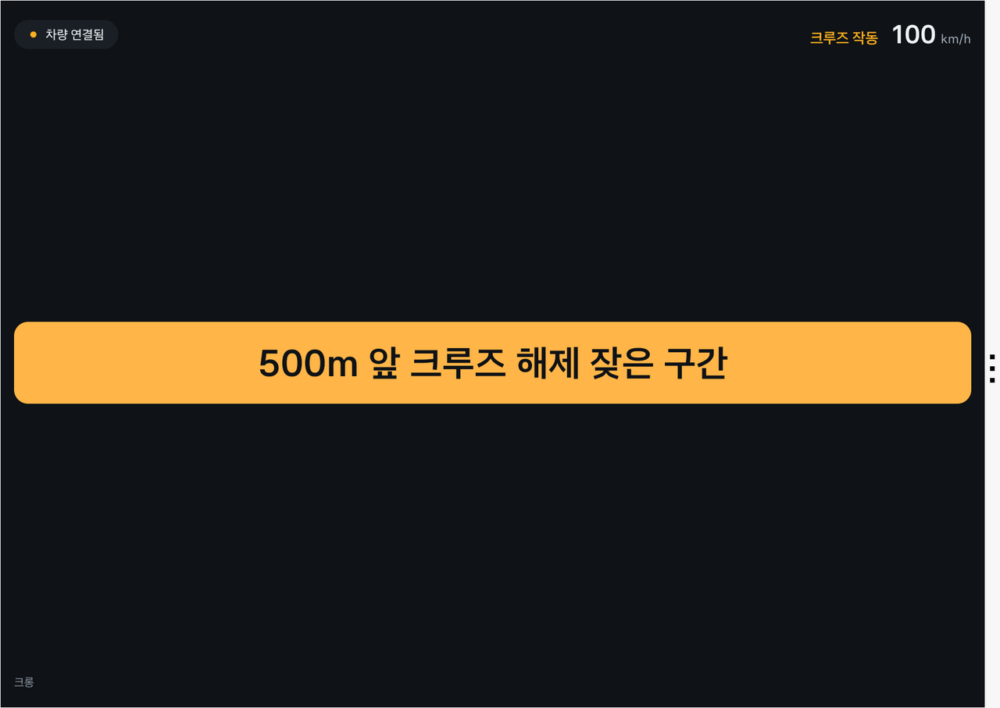
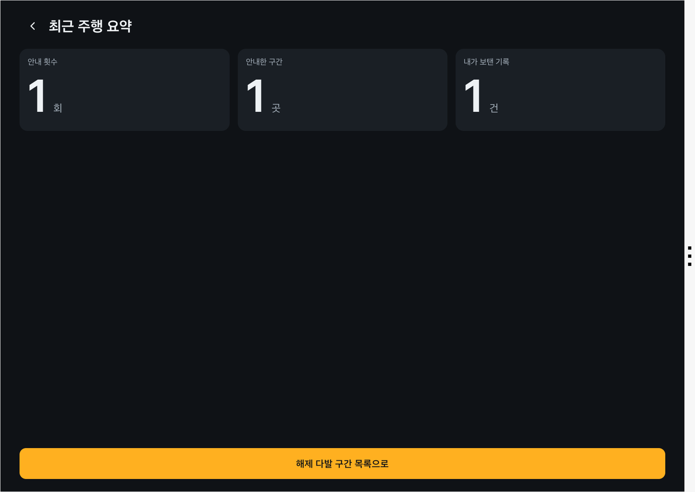
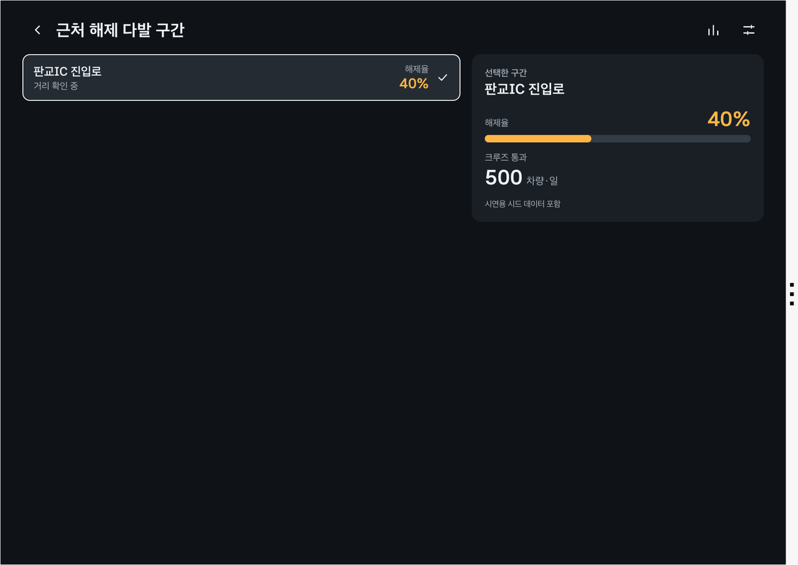
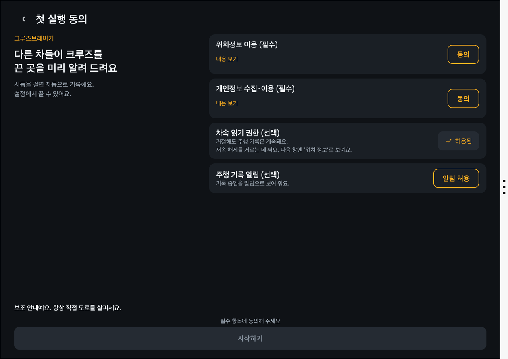
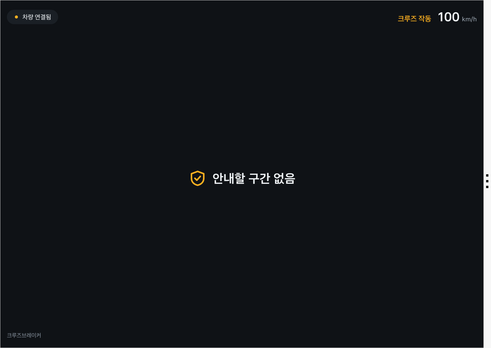

# 크롱 (CRONG) — 앱 프로젝트 소개

<!-- 접수양식 02 파트 원문. tools/build-proposal-docx.py가 "## N." 절을 양식의 N번 칸에 넣는다. 실명·연락처·계정 정보를 쓰지 않는다. -->

## 1. 앱 한 줄 소개

여러 차량이 크루즈 컨트롤을 끈 지점을 모아, **운전자 개입이 반복되는 고속도로 구간을 진입 500m 전에 음성 한 문장으로 알려 주는** 앱 — "다른 차들이 크루즈를 끈 곳에서, 나도 미리 핸들을 잡는다".

앱 이름 크롱(CRONG)은 Cruise Risk Observation & Navigation Guide의 머리글자로, 크루즈 해제 위험을 관찰해 미리 안내하는 길잡이라는 뜻이다.

## 2. 기획 배경

### 불편한 순간: 크루즈를 켜고 마음을 놓은 순간

고속도로에서 스마트 크루즈를 켜면 운전이 편해지는 만큼 주의도 느슨해진다. 그러다 분기점 합류부에서 옆 차가 갑자기 끼어들면 놀라서 브레이크를 밟는다. 이런 곳은 매번 같은 자리인데, 처음 지나는 운전자는 미리 알 방법이 없다.

### 숫자로 본 문제

- **고속도로 사망 사고의 대부분은 주의 저하에서 나온다.** 한국도로공사 집계로 최근 5년간 고속도로 사망 사고 원인의 69.8%가 졸음 등 주시태만이었다. (서울신문, 2022-09) 봄철에는 더 높아 2021~2023년 5월 사망자의 83%가 졸음·주시태만이었다. (한국도로공사 분석, 경북매일 2024-05)
- **지도는 "운전하기 어려운 곳"을 모른다.** 급커브는 지도에 있지만, 합류 차량이 끼어드는 곳, 공사 후 차로가 좁아진 곳, 흐름이 자주 끊기는 곳은 지도 데이터에 없다.
- **순정 기능에도 빈칸이 있다.** 내비게이션 기반 스마트 크루즈(NSCC)는 지도의 곡선 정보로 감속하지만 고속도로 본선에서만 작동하고, 인터체인지·분기점에서는 작동하지 않는다. (현대자동차그룹, 기아 사용자 매뉴얼)

### 왜 해결이 필요한가

운전자가 크루즈를 끄고 브레이크를 밟는 순간은 "이 구간은 자동에 맡기기 어렵다"는 실제 판단이다. 이 판단은 지금 아무 데도 쌓이지 않고 사라진다. 많은 차의 개입 기록을 모으면 **사고가 나기 전 단계의 해제 다발 구간**을 찾을 수 있고, 다음 운전자가 미리 대비할 수 있다.

출처
- 서울신문(2022-09-27, 한국도로공사 "최근 5년" 집계, 연도 범위는 기사에 명시되지 않음): https://m.seoul.co.kr/news/2022/09/27/20220927009005
- 경북매일(2024-05): https://kbmaeil.com/article/202405080393229
- 현대자동차그룹 NSCC: https://www.hyundaimotorgroup.com/ko/tag/navigation-based-smart-cruise-control
- 기아 사용자 매뉴얼: https://ownersmanual.kia.com/full_webhelp/CL4/2026/en_US/topics/t00574.html

## 3. 앱 주요 기능 및 차량 특화 요소

### 핵심 기능

| ID | 기능 | 해결하는 문제 |
|---|---|---|
| F1 | **해제·통과 자동 기록** — 크루즈가 작동 중에서 해제로 바뀌는 구간과 크루즈로 지난 구간을 차가 기록해 바로 올림. 해제 원인은 나누지 않음 | 신고 없이 "개입 지점"이 모임 |
| F3 | **구간 해제율 집계** — 약 150m 구간 × 진행 방향별로, 둘레 칸까지 합쳐 최근 28일 동안 해제한 차량 수 ÷ 크루즈로 지난 차량 수(하루 한 차는 한 번) | 운전자 개인 습관 차이와 우연한 해제를 여러 차의 비율로 상쇄 |
| F4 | **진입 전 음성 안내** — 크루즈 작동 중, 해제 다발 구간 500m 전에 음성 한 문장 + 큰 글씨 배너 한 줄 | 운전자가 미리 직접 운전할 준비 |
| F5 | **주행 후 요약(정차 중)** — 오늘 지난 해제 다발 구간, 안내 횟수, 내 기록의 기여 | 앱의 가치를 체감, 다음 주행 대비 |

### 왜 폰 앱이 아니라 차량 앱인가 (차량 특화 요소)

- **폰은 운전자의 제어 개입을 모른다.** 크루즈 상태와 브레이크는 차량 신호다. GPS 속도 변화만 보는 폰 앱은 "막혀서 느려진 것"과 "운전자가 불안해서 개입한 것"을 구분하지 못한다.
- **수집에 사람 손이 들지 않는다.** 주행 중 신고 버튼을 누를 필요가 없다. 운전 그 자체가 데이터가 된다.
- **안내도 차에 맞게 한다.** 화면을 보지 않아도 되도록 음성 한 문장으로 끝낸다. 주행 중 화면은 배너 한 줄뿐이며 터치 요소가 없다.

### 차량에서의 새로운 경험

운전자는 평소처럼 크루즈를 켜고 달리기만 하면 된다. 해제 다발 구간이 다가오면 "500미터 앞, 크루즈 해제가 잦은 구간입니다" 한 문장이 들린다. 내가 크루즈를 끈 순간은 다른 운전자를 위한 안내가 된다.

### 기존 서비스와의 차이

| 서비스 | 하는 일 | 크롱과의 차이 |
|---|---|---|
| 내비게이션 기반 스마트 크루즈(순정) | 지도의 곡선 정보로 자동 감속 | 도로 형상만 반영. 크롱은 실제 운전자 개입을 반영하고, 분기점·합류부도 포함 |
| 내비 앱의 사고다발 구간 안내 | 사고 통계 기반 위험 구간 | 사고가 난 뒤의 통계. 크롱은 사고 전 단계인 "개입이 잦은 곳"을 찾음 |
| 도로 위험 신고형 서비스 | 운전자가 위험을 직접 신고·공유 | 사람이 신고해야 모임. 크롱은 차량 신호로 자동 수집 |

## 4. 주요 사용 시나리오

**페르소나** — 경부고속도로로 매일 왕복 80km를 출퇴근하는 40대 직장인. 스마트 크루즈를 자주 쓰지만, 분기점에서 갑자기 끼어드는 차 때문에 놀란 적이 여러 번 있다.

**장면 1. 출근길 (주행 중)**
1. 고속도로에 올라 크루즈를 켠다. 앱은 따로 조작하지 않아도 뒤에서 동작한다.
2. 분기점 500m 전, 음성 한 문장: "500미터 앞, 크루즈 해제가 잦은 구간입니다." 화면에는 큰 글씨 배너 한 줄이 10초 동안 표시된다.
3. 운전자는 발을 브레이크 근처에 두고 합류 차량에 대비해 직접 속도를 조절한다.

**장면 2. 내 기록이 데이터가 되는 순간 (주행 중)**
4. 앞 차가 끼어들어 브레이크를 밟자 크루즈가 꺼진다. 이 해제는 자동으로 기록되어 해당 구간의 해제율에 더해진다. 시속 60km 미만에서 꺼진 경우(오래 정차해서 자동으로 꺼진 것 등)는 기록하지 않는다.

**장면 3. 도착 후 (정차 중)**
5. 주차하면 "오늘 해제 다발 구간 3곳 통과, 안내 3회, 내 기록 2건이 반영됐어요" 요약이 보인다. 근처 해제 다발 구간 목록과 구간별 해제율도 확인할 수 있다.

## 5. 개발 계획

### 구조

차량 앱이 크루즈·차속·위치 신호로 해제·통과를 판정하고, 생길 때마다 원래 좌표 대신 구간 ID만 서버로 보낸다. 서버는 구간·방향별 해제율을 집계하고, 앱은 주변 해제 다발 구간을 받아 진입 전에 안내한다.

| 구성 | 역할 |
|---|---|
| 차량 신호 모듈 | Vehicle SDK·AAOS 차속·NaviHelper 호출을 감싸고, 권한·지원 여부를 확인 |
| 해제 감지기 | 크루즈 상태 변화와 차속으로 해제 이벤트를, 크루즈 작동 중 새 구간 진입으로 통과를 판정 |
| 서버(Supabase) | 해제·통과 기록 저장, 구간별 해제율 집계(SQL 뷰, 둘레 칸 합산·최근 28일) |
| 안내기 | 크루즈 작동 중, 진행 방향 앞 500m의 해제 다발 구간을 찾아 음성 + 배너로 1회 안내 |
| 화면 | 주행 배너(주행 중), 해제 다발 구간 목록, 주행 요약, 설정, 첫 실행 동의(정차 중) |

### SDK/API 사용 계획

| 기능 | 용도 | SDK·API | 검증 상태(에뮬레이터 2.1.0) |
|---|---|---|---|
| F1 | 크루즈 상태 | Vehicle SDK `DrivingMode.CruiseControlState` 리스너 | 상태 변경 수신 확인 |
| F1 | 크루즈 설정 속도 | Vehicle SDK `DrivingMode` | 수신 확인 |
| F1 | 차속 | AAOS `PERF_VEHICLE_SPEED` | 수신 확인(7~20Hz) |
| F3·F4 | 위치·진행 방향 | NaviHelper `getCurrentLocationInfo` | 수신 확인 |
| F1 | 다음 진출·요금소까지 거리(정상 해제 제외용) | NaviHelper 회전 안내 `getTBTInfo` / `onTBTInfo` | 수신 확인(경로 안내 중, 안내 종류·거리·문구 14건). 판정 연결은 2차 PT까지 구현 |
| F4 | 음성 안내 | Pleos TTS SDK (기기 내 모드) | 음성 재생 확인 |
| F4 | 주행 중 화면 제한 | 주행 중 사용 선언(DO) + `CarUxRestrictions` | 검증 중 |
| 권한 | 기어·브레이크·크루즈 | `pleos.car.permission.CAR_DRIVE` | 확인 |

### 판정 규칙

| 규칙 | 기준(초기값) |
|---|---|
| 해제 이벤트 | 크루즈 작동이 3초 이상 유지된 뒤 비작동으로 바뀜, 해제 순간 차속 60km/h 이상. 원인(브레이크·정체 등)은 나누지 않음 |
| 크루즈 통과 | 크루즈 작동 중 새 구간에 들어설 때 1회(해제율의 분모) |
| 해제율 | 같은 방향의 그 구간 + 둘레 8구간을 합쳐, 해제한 차량 수 ÷ 크루즈로 지난 차량 수(같은 차는 하루 한 번), 최근 28일 |
| 해제 다발 구간 | 해제율 30% 이상, 크루즈로 지난 차량-일 20 이상(같은 차는 하루 한 번만 셈) |
| 안내 | 크루즈 작동 중일 때만, 진행 방향 ±30° 안 앞 500m의 해제 다발 구간을 1회. 같은 구간은 한 주행(기어 D~P)에 1회, 안내 간격 최소 3분 |
| 정상 해제 제외 | 경로 안내 중 NaviHelper 회전 안내(TBT)의 다음 안내 지점이 진출(IC·JC 방면)·요금소(`TURN_TOLL`)이고 거리가 1km 이내이면 그 해제는 기록하지 않음(2차 PT까지 구현). 경로 안내 없이 달릴 때는 IC 램프·요금소 위치 데이터(공공데이터 또는 지도 데이터, 출시 전 출처 확정)와 겹치는 구간을 서버 집계에서 제외(출시 적용) |

**"크루즈를 끄는 이유 대부분은 IC 진출·요금소 아닌가?"** — 맞다. 그래서 두 층으로 거른다. ① 우연한 해제(앞차 급제동, 센서 가림)는 장소에 묶이지 않아 여러 차의 비율(30%)과 최소 표본(20 차량-일)에서 자연히 사라진다. ② 장소에 묶이지만 위험이 아닌 해제(진출·요금소 진입)는 비율로는 걸러지지 않으므로, 차량 내비가 이미 아는 "다음 안내 지점"으로 미리 뺀다(에뮬레이터 실측 예: `TURN_RIGHT 700m "대왕판교IC 방면"`, `TURN_TOLL "대왕판교톨게이트"`). 휴게소 진입은 회전 안내에 잡히지 않아 출시 단계의 위치 데이터 제외로 다룬다. 이 두 층을 지나고도 남는 해제 다발 구간이 합류·끼어들기·급커브·상습 정체 시작점 같은 **구조적 개입 지점**이다. 진출 램프 자체의 위험(진출 차량과 본선 차량의 속도 차)은 1단계에서는 다루지 않는다.

### 개발 범위와 일정

| 기간 | 범위 |
|---|---|
| ~11/8 | 해제 감지 + 단위 테스트, 음성 안내 동작 확인, 주행 배너·해제 다발 구간 화면, 서버 테이블 |
| ~11/12 | 안내 규칙, 구간 집계, 시연 스크립트(고정 위치 + 시연용 해제 다발 구간) |
| ~12/2 (2차 PT) | 진출·요금소 앞 해제 제외(NaviHelper 경로 정보), 에뮬레이터에서 고정 위치 + 크루즈·브레이크 신호로 안내·기록 전 과정 시연 |

### 개인정보와 운전 안전

- 원래 좌표는 서버로 보내지 않는다. 약 150m 구간 ID와 8방위 진행 방향, 시간 단위로 내린 시각만 저장한다. 차량 식별값은 앱 설치마다 만드는 무작위 ID(가명)만 쓰고, 기기 정보·차대번호는 쓰지 않는다.
- 주행 중 화면은 배너 한 줄뿐이며, 애니메이션·스크롤·여러 줄 텍스트·터치 요소를 쓰지 않는다. 안내는 운전 관련 내용 한 문장으로 한정하고 반복하지 않는다.
- 첫 실행 때 위치정보·개인정보 동의를 받는다. 동의 전에는 차량 신호를 받지 않고 기록하지 않는다. 차속·알림 권한은 설명을 보여 준 뒤 요청하며, 거부해도 앱을 쓸 수 있다.
- 설정에서 시동 시 자동 기록을 끌 수 있다. 동의를 철회하면 기록을 바로 멈추고, 서버에 올라간 그 차량의 해제·통과 기록을 즉시 삭제한다(삭제 요청이 실패하면 성공할 때까지 다시 보냄).
- 정차 화면은 플랫폼이 터치 화면을 허용할 때(`CarUxRestrictions`)만 연다. 주행 중이거나 허용 여부를 모르면 터치 없는 배너 화면만 보인다.
- 안내는 운전을 돕는 보조 정보다. 첫 실행 화면에 "보조 안내예요. 항상 직접 도로를 살피세요"를 고지하고 약관에 책임 제한을 두며, 안내가 없는 구간을 안전하다고 표현하지 않는다.

## 6. 기대효과 및 발전 가능성

### 사용자에게 주는 가치

- 현대자동차그룹: **운전자가 주행 보조를 끄고 직접 개입한 지점**은 ADAS를 개선할 때 가장 값진 실주행 데이터다. 폰이나 외부 서비스는 이 신호를 받을 수 없고, 차량 앱이기 때문에 탑재 차량 전체에서 조용히 모인다. 순정 내비 기반 크루즈가 다루지 않는 분기점·합류부의 실제 개입 지점을 지도 위 데이터로 갖게 된다.
- 운전자: 해제 다발 구간을 미리 알고 대비해 크루즈 사용 중 놀라는 순간이 줄어든다. 내 개입 기록이 다른 운전자의 안내가 되는 것을 눈으로 본다.
- 도로 관리자: 사고 통계보다 먼저, 운전자들이 실제로 어려워하는 구간을 데이터로 볼 수 있다.

**"이 데이터는 제조사가 차에서 직접 기록하면 되지 않나?"** — 그럴 수 있다. 크롱이 더하는 것은 세 가지다. ① 운전자가 내용을 읽고 **동의해서 켠** 기록이라 구간 단위로 모아 다른 운전자에게 되돌려 줄 수 있다. ② 되돌려 받는 것(진입 전 안내, 내 기록의 기여)이 있어야 운전자가 기록을 계속 켜 둔다. ③ 앱은 Pleos Connect 탑재 차종에 차종 구분 없이 배포되므로, 해제율 기준·제외 조건 같은 규칙을 순정 기능으로 넣기 전에 실제 주행으로 빠르게 검증할 수 있다. 크롱이 향하는 곳은 별도 앱이 아니라 **순정 내비 경로 안내에 들어갈 기능의 동작하는 시제품**이다.

### 타깃 고객

- **1차 타깃**: Pleos Connect 탑재 차량으로 고속도로에서 크루즈를 자주 쓰는 출퇴근·장거리 운전자.
- **차종을 가리지 않는다.** 크루즈 기능이 있는 차라면 내연·하이브리드·전기차 모두 대상이므로, 국내 첫 탑재 차종인 더 뉴 그랜저(2026-05)와 디 올 뉴 아반떼(2026-08)부터 바로 쓸 수 있다.

### 예상 MAU

| 항목 | 값 | 근거 |
|---|---|---|
| 두 차종 국내 판매(2025) | 그랜저 71,775대 + 아반떼 79,335대 = 연 약 15만 대 | 현대자동차 2025년 판매 실적 |
| 2027년 말 탑재 차량 | 약 23만 대 | 두 차종만, 2025년 판매 수준 유지 가정 |
| 앱 설치율 | 15% | 가정 |
| 월 1회 이상 고속도로 크루즈 사용 | 60% | 가정 |
| **예상 MAU(2027년 말)** | **약 2만 1천** | 230,000 × 0.15 × 0.6 |
| 장기 | Pleos Connect 2030년 글로벌 약 2,000만 대 목표 | 같은 비율 적용 시 MAU 약 180만 |

**안내가 시작되기까지(콜드스타트)**: 해제 다발 구간이 되려면 같은 방향 9칸에 28일 동안 크루즈 통과 20 차량-일이 쌓여야 한다. MAU 2만 1천 중 수도권 등록 비중을 절반(약 1만 대), 그중 월 1회 이상 수도권 고속도로를 달리는 비율을 30%(약 3천 대), 월 평균 4회 통과로 보면 수도권 고속도로 전체에 하루 약 400 차량-일이 생긴다(가정값). 이 중 4분의 1이 경부 판교~양재 같은 간선 한 구간을 지난다고 보면 하루 약 100 차량-일이라 **하루 안에** 분모 20을 넘기고, 통과 차량이 그 100분의 1인 구간도 **28일 집계 기간 안에** 채워진다. 그래서 1단계는 수도권 고속도로부터 안내를 열고, 분모가 모자란 구간은 "관측 중"으로 표시한다.

### Retention

- **낯선 길에서 가장 쓸모 있다.** 처음 가는 고속도로에서는 어디서 차가 끼어드는지 모른다. 안내의 가치는 여기서 가장 크다.
- **익숙한 길에서는 조용해진다(다음 버전).** 매일 같은 자리에서 같은 안내가 반복되면 운전자는 안내를 끈다. 같은 해제 다발 구간을 여러 번 지난 운전자에게는 안내를 줄이고, 그 구간에서의 통과·해제 기록은 계속 쌓아 다른 운전자의 안내에 쓴다.
- **켜 둘 필요가 없다.** 주행하면 자동으로 동작하므로 "앱을 여는 습관"이 없어도 이탈하지 않는다.
- **기여가 보인다.** "내 기록이 다른 운전자 안내에 쓰인 횟수"를 보여 준다.
- **목표: 30일 Retention 40%.** 주행하면 자동으로 동작하고 내 기록의 기여가 눈에 보인다는 점에 근거한 목표이며, 출시 후 실측으로 보정한다.

### 서비스 확대 계획

| 단계 | 내용 | 수익 |
|---|---|---|
| 1단계 | 운전자 무료. 해제·통과 기록 축적, 해제 다발 구간 안내 | — |
| 2단계 | **그룹 ADAS 개발에 실주행 개입 지점 데이터 제공**: 내비 기반 크루즈가 다루지 않는 분기점·합류부의 개입 지도, 개입 전 차속·설정 속도 분포. 운전자 안내(1단계)는 이 데이터를 운전자에게 되돌려 주는 첫 서비스다 | 그룹 내 협업 |
| 3단계 | 한국도로공사·지자체 대상 "운전자 개입 다발 구간" 리포트: 도로 구조 개선·공사 구간 관리 우선순위 근거 | B2G |
| 4단계 | 익숙한 구간 안내 줄이기, 신호 확장(조향·급감속), 시간대·날씨별 위험도, 내비 경로에 해제 다발 구간 미리 표시 | — |

출처
- 현대자동차 2025년 판매 실적: https://www.hyundaimotorgroup.com/ko/news/hyundai-motor-company-sales-4138180-units-2025
- Pleos Connect 2,000만 대 목표·첫 탑재(머니투데이, 2026-04-30): https://www.mt.co.kr/industry/2026/04/30/2026042916243666820

## 7. 참고자료

- GitHub 저장소: https://github.com/hoyeoni1/hyundaiapp-crong (소스 코드 + apk/SamgakGorae_CRONG_release.apk)
- 시연 영상: 【제출 전 기입 — 영상 링크 또는 첨부 파일명】
- 화면: 아래 화면은 제출 release APK를 Pleos Connect 에뮬레이터 2.1.0에서 실행해 찍은 것이다(해제 다발 구간과 다른 차량 기록은 시연용 시드 데이터).

- 시연 데이터 안내: 에뮬레이터에는 모의 주행이 없어 위치를 고정하고 에뮬레이터 위치 앞 400m에 시연용 해제 다발 구간을 두었으며, 크루즈·브레이크·차속은 에뮬레이터 콘솔 주입으로 재현했다. 다른 차량의 기록과 시연용 해제 다발 구간은 시드 데이터다.

## 8. 숏폼 링크

해당 없음
