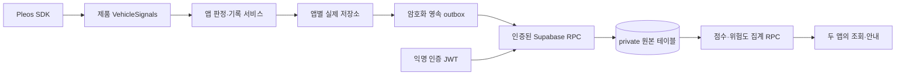

# 두 앱 공통 서버 설명서

기준: 2026-11-03, core v0.5.1. 담당: 황준용.

차슐랭·크루즈브레이커는 **하나의 Supabase 프로젝트**를 공유한다. 서버 코드·SQL·시드·테스트 원본은 [차슐랭 저장소](https://github.com/hoyeoni1/hyundaiapp-chachelin)의 `server/`다. 크루즈 저장소는 공통 Android core와 크루즈용 저장소 구현을 포함한다. DB migration을 두 저장소에서 따로 실행하지 않는다.

## 팀원 빠른 연결 (앱 개발·테스트)

앱을 서버에 붙이는 것만으로는 Supabase 관리자 초대, CLI login/link, DB 비밀번호나 별도 서버 설치가 필요 없다. 팀 공용 프로젝트의 URL과 Publishable key 두 값만 받으면 된다. 개인 PC마다 새 프로젝트/DB를 만들지 않는다.

1. 서버 연결 코드가 있는 버전을 받는다. 현재 차슐랭 PR #10 / 크루즈 PR #22의 `codex/supabase-foundation-20261102` 브랜치이며, 머지 후에는 해당 변경이 반영된 main을 사용한다. Android/Pleos 환경은 [Windows 테스트 환경](windows-local-testing.md)을 따른다.
2. 팀 관리자에게 **현재 Publishable key**(`sb_publishable_...`)를 전달받는다. URL은 `https://qbdikckaqroxbpacvtqo.supabase.co`다. 다른 작업자의 local.properties는 Git에서 받지 못한다. Secret key/service_role/DB 비밀번호는 앱 연결에 사용하지 않는다.
3. 작업하는 앱 저장소 **루트**의 Git 제외 `local.properties`에 아래 두 줄을 추가한다. 기존 `sdk.dir` 등은 유지한다. 두 앱을 모두 빌드하면 각 저장소에 따로 설정한다. `server/.env.local`은 Android 빌드에 사용되지 않는다.

```properties
supabase.url=https://qbdikckaqroxbpacvtqo.supabase.co
supabase.publishableKey=sb_publishable_REPLACE_WITH_CURRENT_TEAM_KEY
```

4. Android Studio Gradle Sync 후 **debug**로 다시 빌드·설치한다. 명령줄 빌드는 저장소 루트에서 ` .\gradlew.bat assembleDebug`다. 값은 빌드 시 APK에 들어가므로 파일만 바꿔서는 설치된 앱이 바뀌지 않는다.
5. 앱에서 수집 동의를 마친 뒤 목록·상세를 조회하고 기록을 시작한다. 제품 저장소가 익명 인증·설치 등록·토큰 갱신을 처리하므로 개발자가 JWT를 직접 만들지 않는다. UI/도메인은 기존 저장소 인터페이스를 계속 사용한다.
6. 서버 연결을 독립 확인하려면 설치한 debug APK에서 아래 검사를 실행한다. adb가 PATH에 없으면 Windows 환경 문서의 platform-tools 경로를 사용한다. 여러 기기가 연결됐으면 각 adb 명령에 `-s <serial>`을 붙인다.

```powershell
# 현재 에뮬레이터 사용자 확인: Pleos의 10을 하드코딩하지 않는다.
$androidUser = (adb shell am get-current-user).Trim()
# 차슐랭. 크루즈는 com.hyundaiapp.cruisebreaker로 바꾼다.
$appId = 'com.hyundaiapp.chachelin'
adb shell am start --user $androidUser -n "$appId/.BackendConnectionCheckActivity"
# 검사가 끝난 뒤 조회. running이면 잠시 후 다시 읽는다.
adb shell run-as $appId --user $androidUser cat files/backend-check-result.json
```

정상 결과는 `ok=true`와 네 가지 checks다. 실제 익명 테스트 사용자/기록을 만드는 검사이며 정상 완료 시 업무 기록과 로컬 인증을 정리한다. 제품 앱 동의와 별도 저장소를 쓰고, 최소 REVOKED/Auth 정리는 운영 문서를 따른다. 로그 확인은 `adb logcat -s SupabaseSync`이며 connected/retry/rejected 상태를 확인한다.

- **Fake가 나온다면**: PR 코드 적용 여부, 두 설정 키 이름·빈 값, 루트 local.properties 위치, 재빌드/재설치를 확인한다. 설정이 비어 있으면 Fake로 동작한다.
- **연결되지만 시드가 안 보인다면**: debug인지 확인한다. debug는 DEMO/SIMULATED, release는 LIVE이며 현재 시드는 시연용이다. SDK 판정까지 검증하려면 별도로 콘솔 주입/화면 리허설을 해야 한다.
- **쓰기 직후 기록이 안 보인다면**: upload 반환은 로컬 영속 큐 등록 완료다. 서버 ACK와 이후 조회까지 기다리고 retry/rejected 로그를 확인한다. 상세 진단은 차슐랭 `server/android-connection.md`를 본다.
- **DB/RPC를 수정하는 작업자만**: Supabase 프로젝트 권한과 자신의 CLI 인증을 별도로 준비한다. 차슐랭 `server/cli-setup.md`를 따르고 기존 migration/시드를 재실행하거나 DB를 reset하지 않는다.

## 1. 서버의 역할과 경계

- 차량 신호 해석·충전 판정·크루즈 해제 판정·배너·TTS는 기존 Android 앱 담당 로직이다.
- 서버는 기록 저장, 재전송 중복 제거, 소유권 검증, 충전소/구간 집계, 철회 삭제를 담당한다.
- 인증과 HTTPS API는 Supabase 관리형 기능, 주요 처리는 PostgreSQL 함수(RPC)다. 별도 PC 호스팅이나 상시 API 서버는 없다.
- 현재는 시연용 충전소·가상 기록을 사용한다. 환경부 공공 API를 주기적으로 받아 갱신하는 함수는 아직 없다.



`core.backend`는 제품 기능에 사용하며 release에도 들어간다. 기존 `core.probe`는 debug 전용 SDK 진단이다. 두 역할은 다르다.

## 2. 저장 구조

앱용 7개와 내부 관리용 2개, 총 9개 테이블을 `pleos_private`에 둔다. 외부에 노출되는 `public`에는 필요한 RPC만 제공한다.

| 테이블 | 핵심 데이터·관계 |
|---|---|
| app_installations | 인증 사용자 → 앱별 설치. 가명 차량 키 해시, 동의 버전, ACTIVE/REVOKED, LIVE/SIMULATED/SEED |
| stations | 공개 충전소 정보·좌표·출력·출처. 기존 st-001~004 시드 ID 유지 |
| charge_sessions | 설치+세션 UUID 복합키. 충전소·SoC·시각·평균 kW·결과·정정 상태 |
| reviews | 설치+세션당 하나. 별점 1~5와 고정 태그. 본인의 유효 SUCCESS 세션만 허용 |
| segments | 7자리 geohash의 중심·도로 이름. 중심은 서버가 격자에서 계산 |
| cruise_events | 설치+격자+방향+시간대 복합키. 원래 좌표·차속·정밀 해제 시각은 저장하지 않음 |
| cruise_passes | 설치+격자+방향+한국 날짜 복합키. 하루 같은 칸 재통과는 한 건 |
| charge_retractions | 업로드보다 실패 정정이 먼저 도착하는 경우를 막는 최소 처리 영수증 |
| migration_versions | 수동 적용 확인용 자체 버전. Supabase CLI 표준 migration 이력과는 별도 |

Auth 사용자 자체는 Supabase `auth.users`에 있다. 사용자 이름·이메일을 받는 별도 프로필 테이블은 만들지 않았다. 세션 시작/종료는 timestamptz, SoC는 0~100 정수, 방향은 0~7, 별점은 1~5로 검증한다. 세부 필드·제약은 `server/schema-design.md`와 실제 SQL이 기준이다.

## 3. 인증·권한

1. 앱의 명시적 동의가 끝나면 Anonymous Sign-In으로 인증 세션을 만든다. 이메일 가입 화면은 없다.
2. JWT의 auth.uid()와 앱 설치를 서버에서 연결한다. 기존 무작위 vehicleId는 앱별 해시로 저장하고, UUID를 안다는 것만으로 타인 데이터를 삭제할 수 없게 한다.
3. 원본 테이블은 비노출 스키마·RLS·권한 회수로 막는다. RPC는 authenticated만 실행할 수 있으며 로그인하지 않은 anon 역할은 실행할 수 없다. 익명 로그인 사용자는 authenticated다.
4. SECURITY DEFINER RPC는 호출자·설치·앱 종류·ACTIVE 상태를 검증한다. 고정 search_path와 제한된 실행 권한을 사용하며 집계에 타인의 인증 ID·차량 키·설치 ID를 넣지 않는다.
5. 공개 Publishable key만 앱에 넣는다. Secret key·DB 비밀번호는 앱/Git/문서 예제에 넣지 않는다. JWKS URL은 직접 운영하는 별도 JWT 서버에 필요할 수 있지만 현재 Android 클라이언트는 Supabase에 JWT를 전달하며 검증은 플랫폼에 맡긴다.

익명 인증은 접근 권한 증명이지 실제 차량 관측값의 진위 증명이 아니다. 설치 초기화로 새 식별자를 만들 수 있어 통계의 '차량-일'은 구현상 '설치-일'이다. 부정 사용 제한·인증 계정 정리 정책은 후속이다.

## 4. API 계약

모든 요청은 `/rest/v1/rpc/<함수명>`으로 POST한다. Publishable key는 apikey 헤더, 사용자 access token은 Authorization: Bearer 헤더에 넣는다. Android의 공통 HttpsBackendTransport가 이를 처리한다. 함수/원본을 임의로 수정하는 관리자 API를 앱에 열지 않는다.

| RPC | 역할·반환 |
|---|---|
| pleos_register_installation | 앱·가명 ID·동의 버전·시연 여부로 설치 등록. 같은 등록은 같은 설치 UUID 반환 |
| pleos_upload_charge | 세션 저장. 같은 ID/같은 내용은 성공, 내용이 바뀐 재사용은 오류 |
| pleos_submit_review | 인증 성공 세션에 후기 하나 저장. 동일 후기 재전송은 성공 |
| pleos_retract_failure | 실패를 화면·집계에서 제외. 없는 세션도 정정 영수증을 남겨 늦은 업로드 차단 |
| pleos_withdraw_installation | 설치 철회와 그 설치의 업무 기록 삭제를 같은 트랜잭션으로 처리 |
| pleos_my_charges | 본인 기록 페이지 조회. ended_at+id 커서를 함께 사용하며 정정 기록 제외 |
| pleos_nearby_stations | 반경 내 충전소와 집계. p_demo로 시연/실측 집계 분리 |
| pleos_station_detail | 충전소/점수, 별점 분포, 상위 태그, 최근 실패 시간대 |
| pleos_upload_pass | 통과 기록을 설치·칸·방향·날짜 단위로 중복 제거 |
| pleos_upload_disengage | 해제 저장과 해당 날짜의 통과 보장을 원자 처리 |
| pleos_nearby_risk | 주변 칸과 방향별 위험도·중심·분자/분모·비율 반환 |

자세한 인수와 SQL은 `server/supabase/migrations/20261102000100_initial_schema.sql`에서 확인한다. void RPC는 HTTP 204도 정상 성공이다. 조회 반경은 최대 50km, 반환은 최대 200개로 제한한다. 현재 위치는 반경 요청으로 서버에 전달되지만 코드에서 위치 기록 테이블이나 앱 로그로 저장하지 않는다. 플랫폼 운영 로그/보관 범위는 별도 확인 대상이다.

## 5. 집계 규칙

### 차슐랭

- 신규 충전소 밖 충전(NOT_AT_STATION 또는 충전소 ID 없음)은 **기기에만 저장**한다. 별도 암호화/noBackup 영속 저장소이며 서버 outbox에 넣지 않는다. 내 기록은 로컬+서버를 합쳐 보여 주고, 철회 시 기기 기록을 즉시 삭제한다. 기존 버전의 서버/outbox 데이터는 소급 이전하지 않는다.

- 현재 점수는 평균 별점이며 후기 5개 미만은 null(평가 중)이다. 실패율 감점은 PRD 초안에만 있고 **구현하지 않았다**.
- 유효 SUCCESS만 인증 수에 포함한다. 평균 kW는 null을 분모에서도 제외한다.
- 최근 7일 FAILED 횟수와 상위 태그·별점 분포는 별도 제공한다. 타인 실패 시각은 원본 대신 시간대 단위로 축약한다.
- FAILED는 충전구/SoC/시간으로 추정한 충전 미진행 기록이다. 충전기 고장을 확정하지 않는다. 잘못된 추정은 [실패 아님]으로 정정한다.

### 크루즈브레이커

- 같은 방향에서 대상 격자+둘레 8칸을 합친다.
- 한국 날짜로 오늘 포함 28일(오늘-27~오늘), 분모는 통과한 DISTINCT 설치-일, 분자는 해제한 DISTINCT 설치-일이다.
- 분모 20 이상 AND 해제율 30% 이상이면 위험. 같은 날 이웃 세 칸을 지난 설치도 한 번만 센다.
- 해제 업로드가 통과도 보장하므로 전송 순서/부분 실패로 분모가 빠지는 것을 막는다.
- 집계는 조회 시 계산한다. 물리 점수 캐시가 없으므로 정정·철회 후 다음 조회에서 다시 계산된다.

## 6. Android 전송·철회

- 두 AppContainer가 공통 core.backend를 생성하고 앱별 Supabase 저장소를 주입한다. 원래 판정기·ViewModel·UI는 팀원의 최신 구현을 유지한다.
- access/refresh token과 전송 대기열은 Android Keystore AES-GCM으로 암호화한 AtomicFile/noBackupFilesDir에 보관한다. 앱·프로젝트·debug/live마다 별도 저장소다.
- upload 반환은 **로컬 대기열 저장 완료**다. 서버 확정은 worker ACK 시점이며 후기 요청은 세션 뒤에 FIFO로 전송한다. 영구 오류는 실패 항목으로 남기고, 일시 오류는 재시도한다. 대기열 상한은 세대당 10,000개다.
- 철회 때 신호·안내를 중지하고, 기존 세대의 전송 대기를 비운 뒤 철회 의도를 영속 저장한다. 서버 ACK까지 옛 인증을 유지하고 새 동의 세대의 인증과 섞지 않는다.
- 모든 서버 쓰기/철회가 같은 설치 행을 잠근다. 먼저 끝난 업로드는 철회가 삭제하고, 철회 뒤 도착한 쓰기는 REVOKED 상태로 거절한다.
- 최신 크루즈 PendingDeletions는 UUID를 별도로 보존한다. SupabaseCruiseServer.deleteMine은 core.awaitWithdrawal로 **서버 ACK까지 기다린 뒤** 반환하므로 앱 삭제 영수증이 먼저 사라지지 않는다.
- 삭제하는 것은 해당 앱 설치의 충전 세션/후기/정정 영수증 또는 크루즈 해제/통과 원본이다. 최소 REVOKED 행과 Auth 사용자까지 즉시 지우는 설계는 아니며 정식 보관·정리 정책은 미정이다.

## 7. 설정·배포·검증

각 저장소 local.properties의 `supabase.url`, `supabase.publishableKey`를 설정하면 실제 서버를 쓴다. 값이 없으면 Fake를 쓴다. debug는 SIMULATED/DEMO, release는 LIVE다. 현재 원격 충전소는 시드뿐이므로 실제 서비스용 LIVE 데이터는 환경부 캐시 연동 후 채워야 한다.

서버 원본 폴더에서 작업한다.

```powershell
# 설치된 CLI를 사용하는 이 PC의 예시
$supabaseCli = Join-Path $env:LOCALAPPDATA 'hyundai-dev\supabase\supabase.exe'
& $supabaseCli db query --linked --file supabase/verify.sql
& $supabaseCli migration list --linked
& $supabaseCli db push --linked --dry-run
```

- initial schema와 demo data 두 migration은 이미 원격에 적용됐고 CLI 표준 이력도 맞췄다. 다시 초기화하거나 db reset하지 않는다. 새 변경은 새 migration으로 추가한다.
- `verify.sql`은 버전·시드 건수·RLS·RPC 권한·함수 fingerprint를 하나의 JSON으로 반환한다.
- 시드 날짜 갱신은 차슐랭 `server/demo-maintenance.md`를 따른다. `supabase/refresh-demo-dates.sql`은 고정 시드 소유자와 건수를 검증한 뒤 한국 날짜에 맞춘다. 실제 앱 데이터는 유지하며 migration 재실행/DB reset은 하지 않는다.
- 시드는 충전소 10곳, 충전 세션 300건, 해제 400건, 통과 2,000건이다. 모두 실제 관측을 대체한 가상 시연 데이터로 구분한다.
- 로컬 PostgreSQL 검증은 `server/`에서 의존성 설치 후 `node --test tests/database.test.mjs`. 소유권·중복·날짜 경계·정정·철회·시드를 실행 검증한다.
- 명시적 원격 검사는 `node tests/remote-smoke.mjs`. 별도 임시 익명 계정과 기록을 만들고 해당 run 표식으로 한정해 정리한다.
- Android 확인은 두 앱의 shell 전용 debug BackendConnectionCheckActivity에서 실제 제품 backend·HTTPS·Keystore·outbox·철회를 검사한다. release에는 이 Activity가 없다.

상세 문서 위치: `server/README.md`(진입점), `schema-design.md`(필드/제약), `deploy.md`(최초 배포), `cli-setup.md`(CLI), `android-connection.md`(앱 연결/재현/한계). Windows SDK 환경은 이 저장소 `docs/windows-local-testing.md`다.

## 8. 현재 범위 밖·팀 검토 항목

- WorkManager에 의한 앱 프로세스 종료 후 독립 재시도. 현재는 실행 중/다음 앱 실행에서 이어 보낸다.
- 철회 대기 UI, 전체 과거 기록의 영속 오프라인 읽기 캐시, 콜백→저장소 전의 앱 메모리 채널 상한/재시도 정책(#19).
- 환경부 API 캐시, 점수 감점 공식, 실제 보관 기간/Auth·차단 정보/백업 정리, 약관 전문. 28일은 집계 기간이며 삭제 기간이 아니다.
- 원격 다중 연결의 철회-업로드 스트레스 검사, 최신 전체 제품 UI의 SDK 시연 리허설, 실차 검증.
- CAR_INFO가 없는 배터리 용량 getter는 core v0.5.1에서 제거했다. 새 권한은 추가하지 않고 차종 프리셋을 사용한다. 선택적 경로 요청/취소도 NAVI_ROUTE_SEARCH가 실제로 허용된 경우에만 SDK를 호출한다.

우리 기여는 서버·공통 backend·실제 저장소 연결·Windows 검증이다. 초기 core 기반은 장호연, 충전/크루즈 판정·서비스는 이상준/이민하, 제품 화면·권한 UX는 길민종의 구현이다. 원격 main 머지와 최종 배포 판단은 장호연이 한다.
